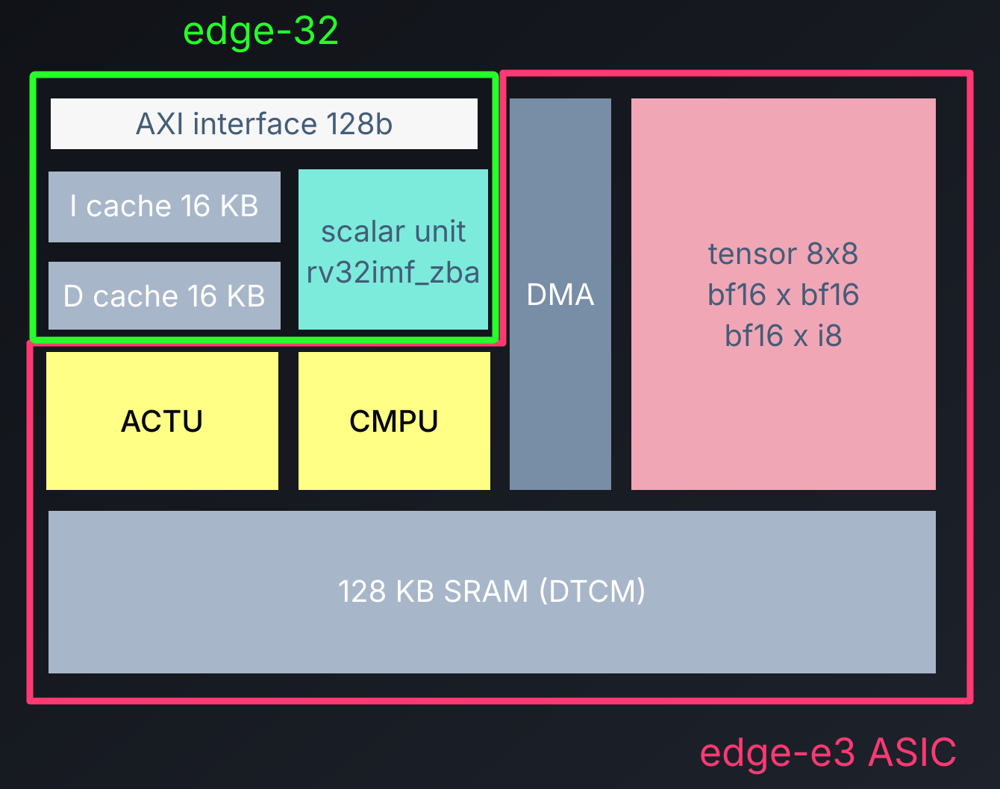

# edge-cores

**The shortest way from PyTorch to ASICs.**

Compile PyTorch models to bare-metal C++ and run them on edge-e3 RTL using
standard LLVM and Verilator. Build on the open-source **edge-32** control
processor and the source-available **edge-e3** reference NPU.

## New in v0.3 and v0.3.1

**MXFP4 · NVFP4 · FP8 E4M3FN / E5M2 · FP4 · Q8_0**

Packed quantized weights, native byte scales, BF22 partial sums, and PyTorch
`nn.Module` wrappers through `import nnc` and `nnc.compile()`. NNC now plans
SRAM tensor storage across the graph and reduces operator control overhead.
See the [v0.3](docs/releases/v0.3.md) and
[v0.3.1](docs/releases/v0.3.1.md) release notes for details and validation.

## PyTorch to ASIC RTL with NNC

After [setup](#setup), use `.venv/bin/python` or activate `.venv` to compose
supported PyTorch/NNC modules and compile the whole graph:

```python
import torch
from torch import nn
from collections import OrderedDict
import nnc

model = nn.Sequential(OrderedDict(
    fc1=nnc.LinearMxFp4(nn.Linear(64, 64, bias=False)),
    act=nn.SiLU(),
    fc2=nnc.LinearNvFp4(nn.Linear(64, 16, bias=False)),
)).eval()

x = torch.ones(9, 64, dtype=torch.bfloat16)
nnc.compile(model, (x,), out_dir="build/nnc-demo", save_reference=True)
```

For runnable models, saved artifacts and simulator runners, see the examples:

| Quantized Linear | Composed models |
| --- | --- |
| [MXFP4](example/linear_mxfp4/README.md) · [NVFP4](example/linear_nvfp4/README.md) | [Llama 3 transformer block](example/llama/README.md) |
| [FP4](example/linear_fp4/README.md) · [Q8_0](example/linear_q8_0/README.md) | [Reduced Qwen 3.6 layer](src/edge-nnc/nnc/test/qwen36_coverage.md) |
| [FP8 E4M3FN](example/linear_fp8_e4m3fn/README.md) · [FP8 E5M2](example/linear_fp8_e5m2/README.md) | |

## Performance Snapshot

Public E3 RTL simulation: **64×64 weights, 128 tokens, BF16 input/output**.
Ideal work takes 8,192 cycles on the 8×8 Tensor array (64 MACs/cycle).

| Operator | Operator cycles | Effective MAC utilization |
| --- | ---: | ---: |
| BF16 Matmul | 9,329 | **87.81%** |
| BF16 Matmul-transpose | 9,243 | **88.63%** |
| NVFP4 Linear | 9,423 | **86.94%** |
| MXFP4 Linear | 9,403 | **87.12%** |
| Q8_0 Linear | 9,210 | **88.95%** |
| FP4 Linear | 9,186 | **89.18%** |
| FP8 E4M3FN Linear | 9,210 | **88.95%** |
| FP8 E5M2 Linear | 9,210 | **88.95%** |

Includes weight DMA, kernel setup, control and synchronization, with operator
I/O in SRAM. Excludes model-boundary I/O and KV-cache traffic.
See the [detailed benchmark report](src/edge-nnc/benchmarks/tensor-64x64-128/README.md)
and [validation record](docs/releases/v0.3.1-validation.md) for measurement
boundaries, capacity sweeps and reproduction. Earlier direct Tensor/activation
measurements are in the [v0.3 report](docs/releases/v0.3-performance.md).

## Weight Formats

NNC's weight-only presets keep activations and outputs in BF16. FP4 presets
use E2M1 weight codes; their scale encoding and K-group size differ:

| Format | Bits per parameter, including group scales | K group | Scale per group |
| --- | ---: | ---: | --- |
| BF16 | 16 | — | None |
| Q8_0 | 8.5 | 32 | FP16, 16 bits |
| FP4 | 4.5 | 32 | BF16, 16 bits |
| NVFP4 | 4.5 | 16 | E4M3FN, 8 bits + one global scale per weight tensor |
| MXFP4 | 4.25 | 32 | E8M0, 8 bits |

K group is the number of consecutive input-channel weights sharing a scale
within one output channel. Bits per parameter count weight codes and group
scales, excluding tail padding and NVFP4's global scalar. This runtime rounds
that global scale to BF16 and stores it in an FP32 container. See the
[quant Linear](src/edge-nnc/QUANT_LINEAR.md) and
[native FP4](src/edge-nnc/MICROSCALE_LINEAR.md) contracts for packing and numerical details.

## Setup

Use the [edge-bringup skill](.codex/skills/edge-bringup/SKILL.md) for macOS or
Ubuntu dependencies, public submodules and initial smoke tests. In Codex,
ask: **Use `$edge-bringup` to set up this machine.**
`scripts/setup-python.sh` installs PyTorch and editable NNC into `.venv`.

## Build on Edge

[Integrate your accelerator](.codex/skills/integrate-your-design/SKILL.md) ·
[Intrinsic manual](src/edge-e3/include/README.md) ·
[Public regressions](tests/README.md) · [Synthesis](synth/README.md) ·
[Contributing](CONTRIBUTING.md) · [Research citation](references.bib)

Workspace software is Apache-2.0; edge-32 is CERN-OHL-P-2.0. Edge-e3 uses its
own source-available hardware license. See [licensing](LICENSING.md).

## Current Project Architecture

- **[edge-32](src/edge-32/README.md)**: RV32 control processor, including the
  scalar pipeline, FPU, caches, bus interface and accelerator instruction path.
- **[edge-asic](src/edge-asic/README.md)**: Shared accelerator building blocks,
  including arithmetic primitives, ACTU/CMPU and DMA/stream plumbing, reused
  across Edge products.
- **[edge-e3](src/edge-e3/README.md)**: Reference NPU integrating the edge-32
  RV32 control core with edge-asic building blocks. E3 supplies the product
  topology, scheduling, 8×8 Tensor unit, DMA/DTCM integration and software SDK.
- **[edge-nnc](src/edge-nnc/README.md)**: PyTorch model compiler and matched
  bare-metal C++ operator runtime. It lowers graphs, plans tensor storage,
  packs static weights and generates code for execution on E3.



## From the E3 MVP to Larger NPU Systems

- **E3 is the minimum viable core:** an 8×8 Tensor array and 128 KiB SRAM,
  providing a runnable platform for validating the control core, DMA, compiler
  and operator kernels.
- **Target 64-token prefill chunks or larger.** NNC's design and the
  [token-capacity benchmarks](src/edge-nnc/benchmarks/tensor-64x64-128/README.md#token-capacity-sweep-same-operators)
  motivate processing enough tokens together to amortize weight DMA and
  control overhead; the measured 64/128-token capacities are more efficient
  than 32-token capacity on the tested workload.
- **Aim for about 1 MiB SRAM per NPU core.** Keep most intermediate layer
  inputs/outputs in SRAM as a chunk moves through the model. Reuse resident
  inputs and head-local attention buffers; model-boundary I/O, weights and
  KV-cache traffic use DMA. Required capacity depends on tensor lifetimes,
  precision and tiling.
- **Pair that SRAM budget with a 32×32 or 32×64 Tensor array.** These are
  proposed configurations for balancing compute capacity with local storage
  and data supply beyond the E3 MVP.
- **Scale to multiple NPU cores and multiple DRAM interfaces.** Distribute
  work and weights across cores and memory groups so external bandwidth can
  grow alongside compute capacity.

The larger SRAM, Tensor arrays and multi-core/memory topology are design
targets. The published benchmark results measure the current E3 MVP.
